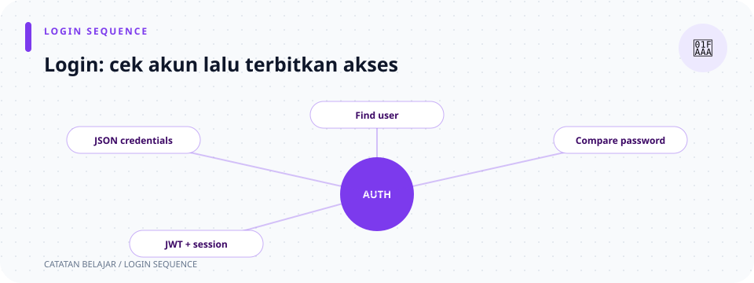

# `src/handlers/auth.rs`

> **Navigasi:** [Indeks catatan](../../README.md) · [README proyek](../../../README.md) · [Endpoint API](../../../endpoin.md)



[Buka kode sumber `auth.rs`](../../../src/handlers/auth.rs)

## Tanggung jawab dan alur request

`auth.rs` menjadi facade handler akun yang memisahkan alur login, registrasi, session, dan admin. Masing-masing handler membaca payload, menjalankan validasi input, memanggil layanan/repository, lalu menyusun response HTTP.

```text
handlers/auth.rs
├── login.rs     → POST /api/auth/login
├── register.rs  → POST /api/auth/register
├── session.rs   → GET session dan POST logout
├── admin.rs     → kelola akun dan role
├── payload.rs   → DTO request
└── shared.rs    → validasi username bersama
```

```text
public register/login ──→ validasi input ──→ auth/repository ──→ response
protected request ──→ middleware memverifikasi identitas ──→ pengguna_saat_ini/logout/admin
```

Route login dan registrasi bersifat publik. Route identitas, logout, dan admin dilindungi middleware; middleware memasukkan `AuthIdentity` ke request sebelum memanggil handler. Session cookie tetap dikelola `tower-sessions`.

Middleware memeriksa identitas pengguna dan izin berdasarkan role serta HTTP method/path. Role admin dapat mengakses route terlindungi; buyer dapat membaca dan membeli laptop; restocker dapat membaca serta melakukan PATCH laptop. Operasi admin memerlukan role admin. Handler `buat_pengguna` dan `ubah_peran_pengguna` tetap melarang menetapkan role admin dari request.

## Sintaks dan tipe yang dipakai

### Extractor dan signature

Contoh parameter login:

```rust
pub async fn masuk(
    State(pool): State<PgPool>,
    Extension(jwt): Extension<JwtService>,
    session: Session,
    Json(payload): Json<LoginPayload>,
) -> Response
```

- `pub` membuat fungsi tersedia bagi router; `async` memungkinkan operasi I/O ditunggu dengan `.await`.
- `State<PgPool>` mengambil pool bersama dari state router. Pola `State(pool)` langsung membongkar wrapper dan mengikat isi ke variabel `pool`.
- `Extension<JwtService>` mengambil layanan JWT yang dipasang sebagai extension oleh router. Pola `Extension(jwt)` juga membongkar wrapper.
- `Session` adalah extractor session dari `tower-sessions`.
- `Json<LoginPayload>` membaca body JSON dan mencoba men-deserialize-nya menjadi tipe payload. `Json(payload)` mengikat nilai hasil baca ke `payload`.
- `-> Response` berarti fungsi mengembalikan response HTTP umum, bukan `Result` dengan satu tipe sukses. Bentuk ini cocok untuk handler yang memilih banyak status berbeda.

Jika body tidak cocok dengan tipe payload, extractor `Json` menolak request sebelum badan fungsi berjalan. `Response` bukan `Result`: kegagalan dan keberhasilan dibentuk sebagai response secara eksplisit, biasanya melalui helper `response`.

### Payload dan `derive`

`LoginPayload` dan `RegisterPayload` memakai `CredentialsPayload` dengan field `username: String` dan `password: String`; `CreateUserPayload` juga mempunyai `role: UserRole`; `UpdateUserRolePayload` hanya mempunyai `role`. Atribut `#[derive(Deserialize)]` meminta Serde menghasilkan kode untuk membaca field JSON ke struct. `#[serde(deny_unknown_fields)]` membuat field JSON yang tidak dikenal ditolak. Field hanya dibuka ke modul handler akun yang memerlukannya.

Deserialize hanya memeriksa bentuk dan tipe JSON. Aturan seperti username tidak kosong, batas 100 karakter, password tidak kosong, dan larangan menetapkan role admin diperiksa oleh handler.

### `Result`, `match`, `if let`, dan `await`

Fungsi `validasi_nama_pengguna` memakai `Result<&str, &'static str>`: `Ok(&str)` berisi potongan teks yang meminjam username asli, sedangkan `Err(&'static str)` berisi pesan statis dari string literal. Referensi `&str` pada hasil tetap mengacu ke string dalam payload yang masih hidup selama handler memakainya. Handler menggunakan `match` untuk menangani kedua kemungkinan secara eksplisit. Pada pemanggilan database, `.await` menunggu operasi asinkron. Handler auth biasanya memakai `match` atau `if let Err(...)` alih-alih `?`, karena perlu mencatat error dan mengubahnya menjadi pesan/status HTTP tertentu.

`match` harus mencakup hasil yang mungkin, seperti `Ok(true)`, `Ok(false)`, dan `Err(error)`. `if let Err(error) = ...` menangani hanya bentuk error yang relevan; jika bukan error, bloknya dilewati.

## Pemeriksaan username

### `validasi_nama_pengguna(username: &str) -> Result<&str, &'static str>`

Fungsi bersama di `shared.rs` meminjam teks (`&str`) alih-alih mengambil kepemilikan `String`. `trim()` menghasilkan potongan teks tanpa whitespace pinggir, lalu `chars().count()` menghitung karakter Unicode. Fungsi menolak username kosong dan yang panjangnya lebih dari 100 karakter; batas 100 diterima. Nilai `Ok(username)` mengembalikan potongan yang telah dibersihkan untuk digunakan handler.

```text
"  rizki  " → trim → Ok("rizki")
"   "       → Err("Username wajib diisi")
101 karakter → Err("Username maksimal 100 karakter")
```

## Fungsi handler, satu per satu

### `masuk(State(pool), Extension(jwt), session, Json(payload))`

1. Memanggil `validasi_nama_pengguna` dan memakai `match`: username valid diteruskan, sedangkan `Err(message)` langsung menjadi `400 Bad Request`. Password kosong juga menghasilkan 400.
2. Menunggu `auth::autentikasi_pengguna(&pool, username, &payload.password).await`. Layanan memverifikasi password lalu mengambil identitas akun. `Ok(None)` menjadi `401 Unauthorized`, `Ok(Some(...))` berisi ID dan role, sedangkan error dicatat dan menjadi 500.
3. Meminta `jwt.terbitkan_token(user_id)` membuat token. Error penerbitan dicatat dan menghasilkan 500.
4. Mendaftarkan `jti` di Redis dengan TTL sampai `exp`. Jika gagal, handler mengembalikan 500 tanpa membuat login session.
5. Memanggil `session::mulai_sesi(&session, username, &jti).await` untuk menyimpan username dan ID token pada session Redis. Jika gagal, handler mencabut token yang baru didaftarkan lalu mengembalikan 500.
6. Mengembalikan response sukses berisi username, role, access token, tipe `Bearer`, dan `expires_in`. Session manager mengurus cookie; handler tidak merakit header cookie sendiri.

`match` dipakai untuk setiap operasi yang dapat gagal agar handler bisa memilih pesan yang sesuai untuk client sekaligus mencatat detail internal server. Kredensial dan role diperiksa/dikelola di layanan auth dan repository, bukan lewat SQL di handler.

### `daftar(State(pool), Json(payload))`

Menggunakan `RegisterPayload` (username dan password), memangkas serta memeriksa username, dan menolak password kosong dengan 400. Lalu `auth::daftarkan_pengguna(...).await` menghasilkan:

| Hasil | Arti | Response |
| --- | --- | --- |
| `Ok(true)` | Akun dibuat | `201 Created`, username dan role default buyer. |
| `Ok(false)` | Username sudah terpakai | `409 Conflict`. |
| `Err(error)` | Operasi gagal | Error dicatat, lalu `500 Internal Server Error`. |

Registrasi publik tidak menerima pilihan role dan tidak membuat login session.

### `buat_pengguna(State(pool), Json(payload))`

Endpoint admin ini membaca `CreateUserPayload` yang berisi username, password, dan role. Ia menjalankan pemeriksaan username/password yang sama, lalu menolak `UserRole::Admin`: role admin hanya boleh diberikan melalui konfigurasi server. `daftarkan_pengguna_dengan_peran(...).await` menyimpan role buyer/restocker yang diminta. Cabang hasilnya sama seperti register: 201, 409, atau 500, dengan role pada data sukses.

`daftar_peran_admin()` menyusun role dari `UserRole::dapat_dibuat_admin()` menjadi pilihan `{value, label, description}` untuk dashboard. Route-nya dilindungi middleware yang sama, sehingga hanya admin dapat membaca daftar tersebut. Role baru perlu memiliki label, deskripsi, izin akses, dan keputusan eksplisit apakah boleh diberikan saat membuat akun.

### `ubah_peran_pengguna(State(pool), Extension(identity), Path(username), Json(payload))`

Middleware menyediakan `identity`; `Path(username)` mengambil nama akun dari URL dan `Json(payload)` membaca role baru. Handler menolak username yang tidak valid, perubahan role untuk akun yang sedang dipakai, dan target role admin dengan 400. Kemudian `ubah_peran_pengguna(...).await` menghasilkan 200 saat berubah, 404 bila pengguna tidak ada, atau 500 bila query gagal. Role baru langsung dipakai pada request selanjutnya; token aktif yang belum dicabut tetap diterima sampai kedaluwarsa.

### `pengguna_saat_ini(Extension(identity))`

Tidak mencari identitas sendiri. Middleware di [`auth/middleware.rs`](../auth/middleware.md) sudah memverifikasi JWT atau session dan menyisipkan `AuthIdentity`; fungsi ini mengembalikan ID pengguna, username, dan role dari nilai tersebut dalam response sukses.

### `keluar(session)`

Mencabut JWT yang terhubung ke bearer request atau session aktif melalui `JwtTokenStore`, lalu memanggil `hapus_sesi(&session).await`. Jika operasi gagal, handler mengembalikan 500; jika berhasil, response menyatakan logout berhasil dan token yang dicabut ditolak pada request berikutnya.

## Ringkasan route

| Method dan path | Handler | Akses dan hasil utama |
| --- | --- | --- |
| `POST /api/auth/register` | `daftar` | Publik; membuat akun buyer. |
| `POST /api/auth/login` | `masuk` | Publik; membuat JWT dan session. |
| `GET /api/auth/session` | `pengguna_saat_ini` | Dilindungi; membaca identitas terverifikasi. |
| `POST /api/auth/logout` | `keluar` | Dilindungi; mencabut JWT terkait di Redis dan menghapus session aktif. |
| `GET /api/admin/roles` | `daftar_peran_admin` | Dilindungi; memberi pilihan role untuk form admin. |
| `POST /api/admin/users` | `buat_pengguna` | Dilindungi; membuat akun buyer/restocker. |
| `PATCH /api/admin/users/{username}/role` | `ubah_peran_pengguna` | Dilindungi; mengubah role target yang diizinkan. |

Untuk konfigurasi route, lihat [routes](../routes.md); untuk helper session dan response auth, lihat [session](../auth/session.md) dan [response auth](../auth/response.md).
