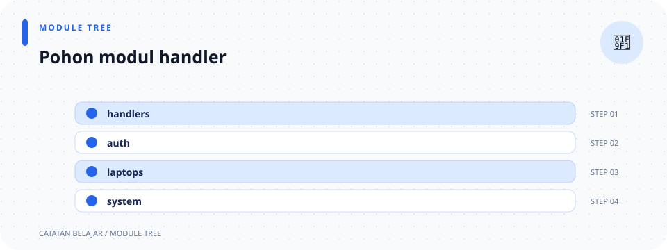

# `handlers/mod.rs`

> **Navigasi:** [Indeks catatan](../../README.md) · [README proyek](../../../README.md) · [Endpoint API](../../../endpoin.md)




[Buka source `handlers/mod.rs`](../../../src/handlers/mod.rs)

## Tujuan

File ini mendaftarkan kelompok handler berdasarkan fitur. Implementasi request berada di modul fitur; nama flat lama tetap diekspor sebagai jalur kompatibilitas.

## Peta modul

```text
handlers
├── auth.rs    → facade handler akun
├── auth/      → login, registrasi, sesi, admin, payload, validasi bersama
├── system.rs  → health check HTTP
└── laptops/   → CRUD inventaris
```

## Penjelasan kode

- `//!` mendeskripsikan modul dan memberi tautan ke catatan ini.
- `pub mod auth;` membuat registrasi, login, pemeriksaan identitas, dan logout tersedia melalui `handlers::auth`.
- `pub mod laptops;` mengelompokkan operasi CRUD pada `handlers::laptops`.
- `pub mod system;` menyediakan pemeriksaan server melalui `handlers::system`.
- `auth.rs` mendaftarkan modul handler akun dan mengekspor fungsi per fitur melalui `handlers::auth`.
- `pub use ...;` mempertahankan jalur lama seperti `handlers::masuk`; router endpoint memakai jalur fitur yang lebih jelas.

Rust mencari `auth.rs` dan `system.rs` di folder `handlers/`, serta `laptops/mod.rs` untuk modul laptop. Submodul `auth/` memisahkan login, registrasi, sesi, admin, payload, dan validasi username bersama.

Detail fungsi ada pada [auth](auth.md), [system](system.md), dan [operasi laptop](laptops/mod.md).

## Posisi dalam alur

Folder [`endpoin/`](../../../src/endpoin/) menghubungkan URL dan method ke handler dengan jalur fitur, misalnya `handlers::auth::masuk` atau `handlers::laptops::daftar_laptop`. Ekspor flat di `handlers/mod.rs` hanya menjaga kompatibilitas pemakai lama. Endpoint privat dan admin dipasang bersama middleware autentikasi/otorisasi di router; handler meneruskan query ke repository.
