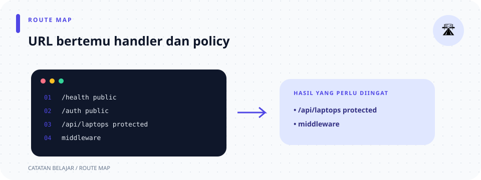

# `src/routes.rs`

> **Navigasi:** [Indeks catatan](../README.md) · [README proyek](../../README.md) · [Endpoint API](../../endpoin.md)




[Buka kode sumber `routes.rs`](../../src/routes.rs)

## Tanggung jawab file

File ini menjadi peta URL API. Ia menentukan method HTTP mana yang memanggil fungsi handler mana, memasang `PgPool` dan verifikator JWT, dan melindungi route admin dengan session cookie atau bearer JWT.

Tidak ada validasi, SQL, atau format response di sini. Pemisahan ini membuat daftar endpoint mudah dilihat dari satu file.

Route `GET /assets/{*path}` juga menyajikan file frontend dari allowlist compile-time. Setiap path harus ditambahkan secara eksplisit pada `aset_frontend`; contoh ilustrasi SVG login ada pada `frontend/images/laptopku-hero.svg`.

## Peta route

```text
Router
├── public: /health, /api/auth/register, /api/auth/login
└── protected: /api/auth/session, /api/auth/logout, /api/laptops/**, /api/admin/users/**
                 ↓ wajibkan_autentikasi (JWT bearer atau session cookie)
               handler
```

## Di halaman ini

[Import](#import) · [Fungsi router](#fungsi-buat_router) · [Urutan setup](#uraian-kode-berurutan) · [Daftar endpoint](#peta-endpoint) · [File terkait](#hubungan-dengan-file-lain)

## Import

| Import | Kegunaan |
| --- | --- |
| `Router` | Tipe router Axum yang menyimpan semua route. |
| `routing::{get, post}` | Pembuat route GET dan POST. Method lain dipanggil sebagai `.patch`, dan `.delete` dari route yang sama. |
| `PgPool` | Tipe state database yang diterima dan dipasang pada router. |
| `SessionManagerLayer` dan `RedisStore` | Menyimpan data session di Redis dan mengelola cookie session. |
| `crate::handlers` | Mengimpor modul yang mengekspor seluruh fungsi handler pada satu namespace. |

## Fungsi `buat_router(...)`

Signature lengkapnya adalah `pub fn buat_router(pool: PgPool, session_cookie_secure: bool, jwt_secret: String, redis_pool: Pool) -> Router`.

- `pub` membuat fungsi dapat dipanggil oleh `main.rs` melalui `routes::buat_router`.
- `pool: PgPool` menerima pool yang sudah dibuat di `config.rs`.
- `session_cookie_secure` menentukan apakah cookie wajib menggunakan HTTPS.
- `jwt_secret` adalah kunci HMAC HS256 untuk menerbitkan dan memeriksa JWT.
- `redis_pool` menyimpan record session agar dapat dipakai setelah backend restart dan oleh instance lain.
- `-> Router` berarti hasil fungsi adalah router yang siap diberikan ke `axum::serve`.
- Fungsi tidak `async` karena ia hanya menyusun konfigurasi route; tidak ada operasi jaringan yang ditunggu.

## Uraian kode berurutan

1. Router publik mendaftarkan `GET /health`, `POST /api/auth/register`, dan `POST /api/auth/login`. Registrasi membuat akun; login memeriksa tabel user, membuat session baru, dan menerbitkan JWT saat password cocok.
2. `protected_routes` mendaftarkan session/logout, operasi laptop, serta route admin untuk membuat pengguna dan mengubah role.
3. `.route_layer(middleware::from_fn_with_state(pool.clone(), auth::wajibkan_autentikasi))` memanggil middleware dari [`auth/middleware.rs`](auth/middleware.md) sebelum request mencapai handler pada grup protected. Middleware memverifikasi bearer JWT atau session, lalu mengambil role terkini dari database untuk otorisasi.
4. Route `"/api/laptops"` memakai satu URL untuk dua method:
   - `get(handlers::daftar_laptop)` untuk mengambil daftar.
   - `.post(handlers::tambah_laptop)` untuk menambah data.
5. Route `"/api/laptops/{id}"` memakai `{id}` sebagai parameter dinamis. Axum mengambil nilai itu sebagai `Path<i64>` pada handler:
   - `get(handlers::ambil_laptop)` untuk detail.
   - `.patch(handlers::ubah_laptop)` untuk perubahan parsial.
   - `.delete(handlers::hapus_laptop)` untuk penghapusan.
6. `Extension<JwtService>` menyediakan konfigurasi JWT kepada middleware dan handler login.
7. `SessionManagerLayer` menggunakan `RedisStore` untuk menyimpan session server-side. Cookie Secure diaktifkan sesuai konfigurasi; cookie tetap dikelola middleware session.
8. `.with_state(pool)` memindahkan pool ke router sebagai state. Setiap request kemudian dapat meminta `State<PgPool>` tanpa membuat koneksi baru.

### Cara membaca signature dan builder

`pub fn buat_router(pool: PgPool, session_cookie_secure: bool, jwt_secret: String, redis_pool: Pool) -> Router` menerima konfigurasi koneksi PostgreSQL, JWT, cookie, dan Redis, lalu mengembalikan `Router` secara langsung. `PgPool` dipasang sebagai state; secret dipindahkan ke `JwtService`, sedangkan Redis pool dipakai oleh `RedisStore`. Builder calls seperti `.route(...).layer(...).with_state(...)` menghasilkan konfigurasi berantai; fungsi tidak memakai `async` karena koneksi Redis sudah dibuka oleh `main.rs`.

`get(handler).post(handler)` memasang beberapa method pada path yang sama. `Router::new()` membuat router kosong, `.merge(protected_routes)` menggabungkan route, dan layer menerapkan middleware/session ke router. Karena route protected dibangun terpisah, middleware autentikasi tidak mengunci endpoint publik.

Method yang tidak didaftarkan pada URL tersebut tidak akan menuju handler ini. Contoh, `POST /health` bukan route yang dibuat file ini. Middleware autentikasi menjawab “siapa yang login”; pemeriksaan `boleh_mengakses` pada role menjawab “apakah role itu boleh memakai method/path ini”.

## Peta endpoint

| Method | URL | Handler | Data tambahan |
| --- | --- | --- | --- |
| GET | `/health` | `cek_kesehatan` | Tidak ada. |
| POST | `/api/auth/register` | `daftar` | `State(pool)`, JSON username/password; publik dan tidak membuat session. |
| POST | `/api/auth/login` | `masuk` | `State(pool)`, `JwtService`, JSON username/password; membuat session dan token bila cocok dengan tabel users. |
| GET | `/api/auth/session` | `pengguna_saat_ini` | Session aktif atau JWT bearer valid (wajib login). |
| POST | `/api/auth/logout` | `keluar` | Session aktif atau JWT bearer valid (wajib login); menghapus session yang dipakai. JWT tetap berlaku sampai kedaluwarsa. |
| GET | `/api/laptops` | `daftar_laptop` | `State(pool)`. |
| POST | `/api/laptops` | `tambah_laptop` | `State(pool)` dan `Json<CreateLaptopPayload>`. |
| GET | `/api/laptops/{id}` | `ambil_laptop` | `State(pool)` dan `Path<i64>`. |
| POST | `/api/laptops/{id}/buy` | `beli_laptop` | `State(pool)`, `Path<i64>`, dan jumlah pembelian dalam JSON. Buyer dapat mengakses endpoint ini. |
| PATCH | `/api/laptops/{id}` | `ubah_laptop` | `State(pool)`, `Path<i64>`, dan `Json<UpdateLaptopPayload>`. |
| DELETE | `/api/laptops/{id}` | `hapus_laptop` | `State(pool)` dan `Path<i64>`. |
| GET | `/api/admin/roles` | `daftar_peran_admin` | Middleware membatasi endpoint ke admin; menghasilkan daftar pilihan role. |
| POST | `/api/admin/users` | `buat_pengguna` | Dilindungi autentikasi; policy role menentukan akses. |
| PATCH | `/api/admin/users/{username}/role` | `ubah_peran_pengguna` | Dilindungi autentikasi; username berasal dari path. |

## Hubungan dengan file lain

[Main](main.md) membuat pool lebih dulu lalu memanggil fungsi ini. [Handlers](handlers.md) menyediakan semua fungsi yang dipasang. State `PgPool` berasal dari [config](config.md). Handler autentikasi dijelaskan di [auth](handlers/auth.md). Untuk perjalanan request lengkap, lihat [alur aplikasi](../02-alur-kerja-aplikasi.md).
